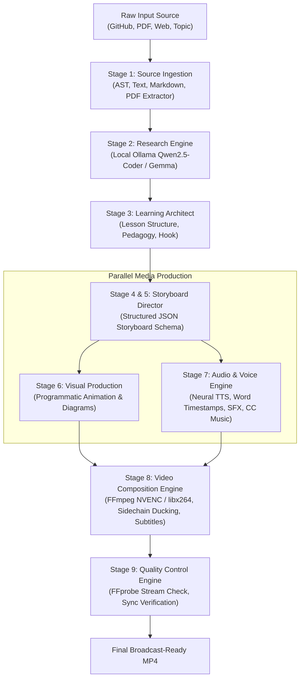

# Visual Learning Studio Architecture

Visual Learning Studio (VLS) is a 100% zero-cost, local-first autonomous video production engine designed to transform technical concepts, GitHub repositories, research papers, and documentation into broadcast-quality educational videos.

## System Topology & Pipeline Flow

The engine implements a 9-stage pipeline, fully orchestrated from initial ingestion through quality-controlled MP4 export:

## Architectural Layers

### 1. Ingestion Layer (`src/ingestion/`)
- Normalizes disparate technical inputs (GitHub repositories, markdown files, PDFs, web documentation, or raw prompt strings) into a structured `KnowledgeBundle`.
- For repositories: automatically scans directory trees, identifies primary programming languages, parses architectural entry points, and extracts illustrative code snippets.

### 2. Cognition Layer (`src/research/` & `src/learning/`)
- Communicates locally with Ollama (`qwen2.5-coder:7b` or `gemma4`) over HTTP (`http://127.0.0.1:11434/api/chat`).
- Implements resilient heuristic fallbacks when Ollama is offline or under memory pressure.
- Formulates pedagogical narratives across three distinct learning modes:
  - **Beginner Explainer:** Conceptual analogies, relatable mental models, progressive jargon introduction.
  - **Technical Deep Dive:** Architecture component decomposition, packet tracing, code syntax highlights, operational trade-offs.
  - **Cinematic Documentary:** Dramatic hook, historical context, visual metaphors, profound system impact.

### 3. Storyboard Layer (`src/storyboard/`)
- Enforces a rigorous Pydantic schema (`Storyboard`, `Scene`, `VisualSpec`, `AudioSpec`).
- Every scene declares exact visual coordinates, node connections, packet flow paths, typography hierarchy, sound effect triggers, and camera framing.

### 4. Generation Layer (`src/generation/`)
- **Programmatic Animator (`programmatic_animator.py`):** Renders dynamic 1080p graphics using mathematical easing (`sine`, `cubic`, `elastic`), procedural glowing particle paths, network topology diagrams, animated data packets, and highlighted code buffers.
- **Pluggable Video Adapters:** Includes `wan2gp_adapter.py` and `sd_adapter.py` for optional GPU acceleration on high-spec hardware.

### 5. Audio Layer (`src/audio/`)
- **TTS Engine (`tts_engine.py`):** Leverages `edge-tts` to produce broadcast-quality neural speech with exact millisecond-accurate word boundary events.
- **Sound Mixer (`sound_mixer.py`):** Performs multi-track mixing with automatic sidechain ducking (reducing background music by -24 dB during narration), smooth exponential fade-ins/outs, and sample-accurate sound effect triggers.

### 6. Composition Layer (`src/composition/`)
- **FFmpeg Engine (`ffmpeg_renderer.py`):** Direct hardware-accelerated compilation using `h264_nvenc` (or `libx264` fallback).
- Performs precise image-sequence to video assembly, scene crossfading, audio-video multiplexing, and burned-in subtitle styling.

### 7. Quality Control Layer (`src/quality/`)
- **Inspector (`inspector.py`):** Executes automated `ffprobe` validation on the exported MP4:
  - Video stream existence, 1920x1080 resolution, target frame rate.
  - Audio stream integrity (stereo 48kHz AAC).
  - Target vs. actual duration tolerance (within ±1.5s).
  - Subtitle track synchronization.
